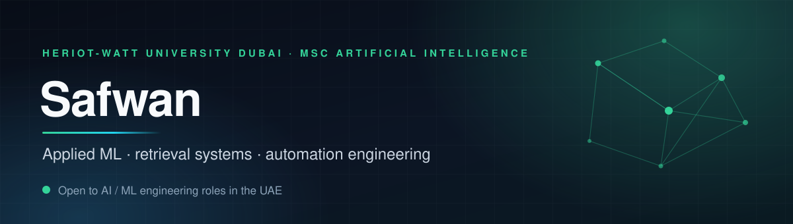

  

#### MSc Artificial Intelligence student at Heriot-Watt University Dubai.

Computer science background, now studying AI. I learn by building small projects — machine learning,
LLMs, a bit of everything — and writing down what worked and what didn't.

---

### Currently

- **Multi-view embroidery defect detection** — F21DL group coursework. Does a second camera angle help
  tell good embroidery from defective embroidery?
- **ClientFlow AI** — a side project: five small business automations on a job queue, with an approval step
  before anything goes out.
- **MLP trained by particle swarm optimisation** — F21BC coursework. The network and the optimiser are kept
  as separate pieces, and compared against logistic regression and k-NN.
- **Reading up on** LLMs and RAG — chunking, evaluation, and where it breaks.

### Projects

- **[ClientFlow AI](https://github.com/safwannxyz/clientflow-ai)** — Business automation proof-of-concept:
  intake triage, KYC pack checks, contract clause review, CV rubric scoring, stalled-work watchdog. SQLite
  schema with migrations, a job queue with retries and a dead-letter box, an audit log, and roles. Synthetic
  data only. `Python` `SQLite` `scikit-learn` `Docker`
- **[CRM Opportunity Tracker](https://github.com/safwannxyz/crm-opportunity-tracker)** — Full-stack CRM for
  moving sales opportunities through each pipeline stage. `React` `Node` `Express` `MongoDB`
- **[Bone-fracture recovery system](https://github.com/safwannxyz/Bone-fracture-recovery-system)** — Regression
  model estimating recovery from knee-injury patient data. `Python` `scikit-learn` `pandas`
- **[Water level monitoring (IoT)](https://github.com/safwannxyz/Water-Level-Monitoring-System-IOT)** — Sensor rig
  with live level readings and alerting, from a MakeSkilled internship. `C++` `Python` `ESP32`

<b>Coursework repositories</b> — private until marking, happy to walk through any of them

 

- **Multi-view embroidery defect detection** (F21DL, group PG18) — 1,080 images at three angles, two
  hypotheses, a preprocessing and splitting pipeline, and a report covering where the data was messier than
  the dataset documentation suggested.
- **MLP trained by particle swarm optimisation** (F21BC) — activations, losses and layers written by hand;
  Algorithm 39 implemented with line-level markers; 880 runs across a hyperparameter grid.
- **Java Swing coursework** (F21SF) — layered application in the module's house style, with JUnit tests.

### Toolbox

  
  
  
  
  
  
  
  
  
  
  
  
  
  

### Activity

  <picture>
    <source media="(prefers-color-scheme: dark)" srcset="https://github-readme-stats.vercel.app/api?username=safwannxyz&show_icons=true&hide_title=true&hide_border=true&include_all_commits=true&rank_icon=github&bg_color=0B1220&title_color=34D399&icon_color=22D3EE&text_color=C9D1D9">
    
  </picture>

---

Dubai, UAE · English, Hindi, Urdu, Telugu · still learning, happy to be corrected on anything here
